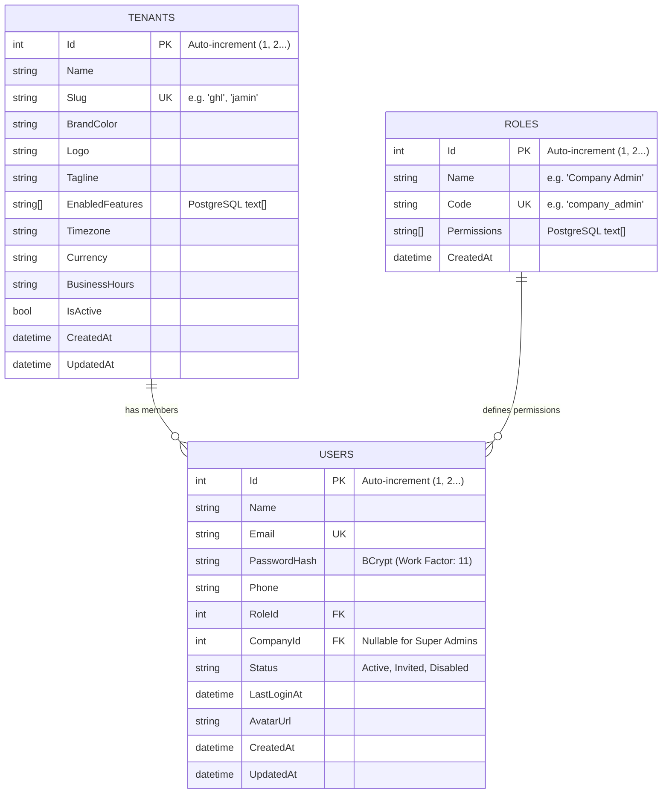

# NexusSales Backend - Authentication & Architecture Documentation

**Platform:** NexusSales Multi-Tenant CRM  
**Module:** Authentication & Multi-Tenancy Core  
**Stack:** ASP.NET Core 8 Web API, Entity Framework Core 8, PostgreSQL, JWT Bearer Auth, FluentValidation  
**Author / Team:** Sales Rep App Engineering Team  
**Date:** September 2026  

---

## 1. Executive Summary

This document provides a comprehensive technical overview of the **Authentication and Tenant Core Backend** implemented for the **NexusSales** platform. 

The backend has been developed from scratch as a modular, production-ready ASP.NET Core 8 Web API, strictly adhering to the frontend data contracts and business requirements. It manages:
- Multi-tenant data segregation with integer-based primary/foreign keys (`1, 2, 3...`)
- Secure password hashing using **BCrypt**
- Asymmetric/Signed **JWT Bearer token** issuance containing role and tenant claims
- Input validation using **FluentValidation**
- Centralized exception handling and standardized API response formats (`ApiResponse<T>`)
- Seamless full-stack integration with the existing React + TypeScript frontend

---

## 2. Architecture & Project Structure

The project follows Clean Architecture / Layered Design patterns within a single maintainable ASP.NET Core project:

```
GHL_AURA/
├── backend/
│   ├── Authentication/
│   │   ├── Interfaces/
│   │   │   └── IJwtService.cs               # JWT issuance contract
│   │   └── Implementations/
│   │       └── JwtService.cs                # Token generation with claims
│   ├── Configuration/
│   │   └── JwtSettings.cs                   # Strongly typed JWT options
│   ├── Controllers/
│   │   └── AuthController.cs                # HTTP endpoints (POST /api/auth/login)
│   ├── Data/
│   │   ├── ApplicationDbContext.cs          # EF Core DbContext & Seed Data
│   │   └── Configurations/
│   │       ├── RoleConfiguration.cs         # Fluent API mapping for Roles
│   │       ├── TenantConfiguration.cs       # Fluent API mapping for Tenants
│   │       └── UserConfiguration.cs         # Fluent API mapping for Users
│   ├── DTOs/
│   │   ├── Auth/
│   │   │   ├── LoginRequestDto.cs           # Email and Password request payload
│   │   │   ├── LoginResponseDto.cs          # Token, User, and Tenant response
│   │   │   ├── RoleDto.cs                   # Role information & permissions
│   │   │   ├── TenantDto.cs                 # Tenant branding & feature flags
│   │   │   └── UserDto.cs                   # User profile representation
│   │   └── Common/
│   │       └── ApiResponse.cs               # Generic standardized envelope
│   ├── Extensions/
│   │   ├── AuthenticationExtensions.cs      # AddJwtAuthentication configuration
│   │   └── ServiceExtensions.cs             # DI container registrations & Swagger
│   ├── Helpers/
│   │   └── PasswordHasher.cs                # BCrypt hashing & constant-time verify
│   ├── Middleware/
│   │   └── ExceptionHandlingMiddleware.cs   # Global unhandled exception handler
│   ├── Migrations/                          # EF Core Code-First Migrations
│   ├── Models/
│   │   ├── Entities/
│   │   │   ├── Role.cs                      # Role entity
│   │   │   ├── Tenant.cs                    # Tenant / Organization entity
│   │   │   └── User.cs                      # Application user entity
│   │   └── Enums/
│   │       └── UserStatus.cs                # Active, Invited, Disabled
│   ├── Repositories/
│   │   ├── Interfaces/
│   │   │   └── IUserRepository.cs           # User database queries
│   │   └── Implementations/
│   │       └── UserRepository.cs            # EF Core query implementation
│   ├── Services/
│   │   ├── Interfaces/
│   │   │   └── IAuthService.cs              # Authentication logic contract
│   │   └── Implementations/
│   │       └── AuthService.cs               # Login orchestration & validation
│   ├── Validators/
│   │   └── Auth/
│   │       └── LoginRequestValidator.cs     # FluentValidation rules
│   ├── .env.example                         # Template for backend/.env (local settings, gitignored)
│   └── Program.cs                           # App startup, middleware pipeline & CORS
└── frontend/                                # React + TypeScript client
```

---

## 3. Database Design & Entity Relationships

The database is built on **PostgreSQL (SalesAppDB)** using EF Core Code-First migrations with PostgreSQL-native types (such as `text[]` for permissions and feature arrays).

All entities use **auto-incrementing integer IDs (`1, 2, 3...`)**:



---

## 4. Pre-Seeded Default Data

The database has been seeded with standard roles, tenants, and demo users. All demo users share the password: **`Password@123`**.

### 4.1 Roles
| ID | Name | Code | Description / Scope |
|---|---|---|---|
| `1` | Super Admin | `super_admin` | Full platform operator privileges across all tenants. |
| `2` | Company Admin | `company_admin` | Full administrative control within their specific tenant. |
| `3` | Sales Executive | `sales_executive` | Field sales, client calling, leads, site visits, and bookings. |
| `4` | IRM | `irm` | Investor Relationship Management, KYC, consultations, and fund opportunities. |

### 4.2 Tenants
| ID | Slug | Name | Primary Domain / Focus |
|---|---|---|---|
| `1` | `ghl` | GHL India Ventures | Institutional Wealth & Real Estate Investment Advisory |
| `2` | `jamin` | Jamin Bazaar | Premium Plotted Enclaves & Farmland Communities |

### 4.3 Demo User Accounts
| ID | Role | Tenant | Email | Password |
|---|---|---|---|---|
| `1` | Super Admin | *Platform-wide* | `yanosh@ghlindiaventures.com` | `Password@123` |
| `2` | Company Admin | GHL India (`1`) | `vishnu@ghlindiaventures.com` | `Password@123` |
| `3` | Sales Executive | GHL India (`1`) | `naveen@ghlindiaventures.com` | `Password@123` |
| `4` | Company Admin | Jamin Bazaar (`2`) | `mani@ghlindiaventures.com` | `Password@123` |
| `5` | GHL IRM | GHL India (`1`) | `dhinakaran@ghlindiaventures.com` | `Password@123` |

---

## 5. API Specification: Login

### Endpoint
`POST /api/auth/login`

- **Authentication:** `[AllowAnonymous]`
- **Content-Type:** `application/json`

### 5.1 Request Body
```json
{
  "email": "vishnu@ghlindiaventures.com",
  "password": "Password@123"
}
```

### 5.2 Success Response (`200 OK`)
```json
{
  "success": true,
  "message": "Login successful",
  "data": {
    "token": "eyJhbGciOiJIUzI1NiIsInR5cCI6IkpXVCJ9...",
    "user": {
      "id": "2",
      "name": "Vishnu",
      "email": "vishnu@ghlindiaventures.com",
      "phone": "+91 98450 11223",
      "role": {
        "id": "2",
        "name": "Company Admin",
        "code": "company_admin",
        "permissions": [
          "leads.view", "leads.create", "leads.update", "leads.delete",
          "customers.view", "customers.create", "deals.view", "..."
        ]
      },
      "companyId": "1",
      "companySlug": "ghl",
      "companyName": "GHL India Ventures",
      "status": "Active",
      "lastLogin": "Just now",
      "avatar": null
    },
    "tenant": {
      "id": "1",
      "name": "GHL India Ventures",
      "slug": "ghl",
      "brandColor": "#0284c7",
      "tagline": "Institutional Wealth & Real Estate Investment Advisory",
      "enabledFeatures": [
        "leads", "customers", "deals", "followups", "calls",
        "call-recording", "call-transcription", "investors", "..."
      ],
      "timezone": "Asia/Kolkata (IST)",
      "currency": "₹ INR",
      "businessHours": "09:30 AM - 07:00 PM IST"
    }
  },
  "errors": []
}
```

### 5.3 Error Responses

#### `401 Unauthorized` (Invalid Credentials / Non-existent User)
Prevents account enumeration by returning the exact same generic error message regardless of whether the email or password was incorrect:
```json
{
  "success": false,
  "message": "Invalid email or password.",
  "data": null,
  "errors": []
}
```

#### `400 Bad Request` (Validation Failure)
```json
{
  "type": "https://tools.ietf.org/html/rfc9110#section-15.5.1",
  "title": "One or more validation errors occurred.",
  "status": 400,
  "errors": {
    "Email": ["A valid email address is required."],
    "Password": ["Password is required."]
  }
}
```

---

## 6. Security & Architectural Best Practices

1. **Password Security**:
   - Uses `BCrypt.Net-Next` with a work factor of 11.
   - Salt is automatically managed and embedded within the hash string.
   - Password hashes are never returned in DTO responses.

2. **JWT Claims Architecture**:
   - Issued tokens contain standard and custom claims:
     - `sub`: User ID (`int.ToString()`)
     - `name`: User Full Name
     - `email`: User Email
     - `role`: Role Code (`company_admin`, `sales_executive`, etc.)
     - `company_id`: Tenant ID
     - `company_slug`: Tenant Slug (`ghl`, `jamin`)
     - `jti`: Unique token GUID for token tracking
   - Tokens are validated via `AddJwtBearer` middleware with issuer, audience, and secret key checks.

3. **CORS Policy**:
   - Configured specifically to allow the React development client (`http://localhost:5173`) with headers, credentials, and methods enabled.

4. **Global Exception Handling**:
   - `ExceptionHandlingMiddleware` catches all unhandled server exceptions, logs the details, and returns a clean, safe `500 Internal Server Error` response without exposing raw database connection strings or stack traces.

---

## 7. How to Run Locally (Step by Step)

These steps run the API directly on your machine with `dotnet run`. If you would rather run the whole stack (API + PostgreSQL + frontend) in containers without installing .NET, see [`../DOCKER.md`](../DOCKER.md).

All commands below are for **PowerShell on Windows**, run from the repository root (`GHL_AURA/`) unless a step says otherwise.

### Why the backend usually fails to start

If `dotnet run` or `dotnet ef database update` fails, compare your error with this table first:

| What you see | Why it happens | Fix |
|---|---|---|
| `No .NET SDKs were found` | Only the .NET **runtime** is installed. Building and running from source needs the **SDK**. | [Step 1](#step-1--install-the-prerequisites) |
| `Could not execute because the specified command or file was not found` (when running `dotnet ef`) | The EF Core CLI tool is not installed. It does not come with the SDK. | [Step 1](#step-1--install-the-prerequisites) |
| `JwtSettings:SecretKey must be at least 32 characters long` | There is no `backend/.env` or `appsettings.json`. Both are gitignored, so a fresh clone has neither. | [Step 2](#step-2--create-your-local-settings-file-backendenv) |
| `dotnet ef database update` fails on a **new, empty** database | The historical migration chain cannot build an empty database from scratch. | [Step 3, Option B](#option-b--local-postgresql-brand-new-empty-database) |
| `Failed to connect to 127.0.0.1:5432` / `password authentication failed` | PostgreSQL is not running, or the connection string is wrong. | [Step 3](#step-3--choose-a-database) |
| `[WARNING] There are N pending EF Core migration(s)` at startup | The database is behind the code. | [After pulling new code](#after-pulling-new-code) |
| `address already in use` / port `5106` busy | Another copy of the API is already running. | Stop the other process, or close the other terminal. |

### Step 1 — Install the prerequisites

1. **.NET 8 SDK** (required). Run the following command and approve the Windows admin (UAC) prompt:
   ```powershell
   winget install --id Microsoft.DotNet.SDK.8 --exact
   ```
   Or download it from <https://dotnet.microsoft.com/download/dotnet/8.0>. Choose the **SDK**, not "Runtime" or "ASP.NET Core Runtime".

   Open a **new** terminal and confirm an `8.0.x` SDK is listed:
   ```powershell
   dotnet --list-sdks
   ```

2. **EF Core CLI** (only needed if you will run `dotnet ef` commands). Open a new terminal afterwards so `dotnet ef` is on your PATH:
   ```powershell
   dotnet tool install --global dotnet-ef --version 8.0.11
   dotnet ef --version
   ```

3. **PostgreSQL 16** (optional, only for Step 3 Options B and C):
   ```powershell
   winget install --id PostgreSQL.PostgreSQL.16 --exact
   ```
   Remember the password you set for the `postgres` user during installation.

### Step 2 — Create your local settings file (`backend/.env`)

The API reads `backend/.env` on startup (via DotNetEnv), and so does `dotnet ef`. This file is gitignored. Never commit it.

```powershell
Copy-Item backend\.env.example backend\.env
```

Generate a random JWT secret and paste it into `JwtSettings__SecretKey` in `backend\.env`:

```powershell
$bytes = New-Object byte[] 48
[System.Security.Cryptography.RandomNumberGenerator]::Create().GetBytes($bytes)
[Convert]::ToBase64String($bytes)
```

```powershell
notepad backend\.env
```

`JwtSettings__SecretKey` is the only required value. Without it the API stops immediately at startup.

### Step 3 — Choose a database

Pick **one** option and set it in `backend\.env`.

#### Option A — In-memory (fastest, nothing to install)

Leave `ConnectionStrings__DefaultConnection` empty. On startup you will see:

```
[Database] WARNING: Running with in-memory database. Password changes and state will not persist across restarts.
```

Demo users (section 4) are seeded automatically. **All data is lost when the API stops.** This option is good for frontend work and quick API checks. The PostgreSQL-specific startup patches are skipped in this mode, so anything database-specific should be tested with Option B.

#### Option B — Local PostgreSQL, brand-new empty database

1. Create an empty database (use the `postgres` password from Step 1):
   ```powershell
   & "C:\Program Files\PostgreSQL\16\bin\createdb.exe" -U postgres ghl_aura_local
   ```
2. In `backend\.env`, set:
   ```env
   ConnectionStrings__DefaultConnection=Host=localhost;Port=5432;Database=ghl_aura_local;Username=postgres;Password=YOUR_LOCAL_PASSWORD
   Database__EnsureCreated=true
   ```
3. **Do not** run `dotnet ef database update` for this database. On first start, the API creates the full schema and demo data from the current model. This is the same approach as the Docker setup.

> `Database__EnsureCreated=true` only works in the `Development` environment. It does not record EF migration history. After a model change, drop and recreate the local database (`dropdb` then `createdb`) and start the API again.

#### Option C — Existing database that was built with migrations

Use this only for a database that already has EF migration history, such as a restored copy of staging. **Never point your local machine at the production database.**

1. In `backend\.env`, set `ConnectionStrings__DefaultConnection` to that database, and keep `Database__EnsureCreated=false`.
2. Apply any pending migrations from the `backend` folder:
   ```powershell
   cd backend
   dotnet ef database update
   ```
   Keep `ASPNETCORE_ENVIRONMENT=Development` in `backend\.env`. The `DisableDemoUsers` migration checks this value, and if it is not `Development` it disables demo accounts.

### Step 4 — Run the API

```powershell
cd backend
dotnet run --launch-profile http
```

The first run restores NuGet packages and can take a minute. The API is ready when you see:

```
Now listening on: http://localhost:5106
```

Swagger opens automatically in your browser. You can also go to **<http://localhost:5106/swagger>**.

Press `Ctrl+C` to stop the API.

### Step 5 — Check that it works

In a **second** terminal:

```powershell
# Liveness (should return status = Live)
Invoke-RestMethod http://localhost:5106/health/live

# Login with a demo user (should return a token)
Invoke-RestMethod -Method Post -Uri http://localhost:5106/api/auth/login `
  -ContentType 'application/json' `
  -Body '{"email":"vishnu@ghlindiaventures.com","password":"Password@123"}'
```

To call protected endpoints in Swagger, copy the `token` value, click **Authorize**, and paste the token.

### Step 6 — Run the frontend (optional)

In another terminal:

```powershell
cd frontend
npm install
npm run dev
```

Open **<http://localhost:5173>** and log in with `vishnu@ghlindiaventures.com` / `Password@123`.

You do not need to set `VITE_API_URL`. The Vite dev server forwards `/api`, `/uploads` and `/hubs` to `http://localhost:5106` automatically.

### After pulling new code

| Your database | What to do when new files appear in `backend/Migrations/` |
|---|---|
| Option A (in-memory) | Nothing. Restart the API. |
| Option B (`EnsureCreated`) | If the model changed, drop and recreate the local database, then start the API. |
| Option C (migrations) | `cd backend` then `dotnet ef database update`, with `ASPNETCORE_ENVIRONMENT=Development` set in `backend\.env`. |

If the database is behind the code, the API prints a yellow `[WARNING] There are N pending EF Core migration(s)` banner at startup.

### Useful extras

- **Verbose logging** (SQL queries and request logs): `$env:LOG_LEVEL = "debug"; dotnet run --launch-profile http`
- **HTTPS profile**: `dotnet run --launch-profile https` serves `https://localhost:7223`. Run `dotnet dev-certs https --trust` once first.
- **Ready-made requests**: open [`backend.http`](backend.http) in VS Code (REST Client extension) or Visual Studio.
- **Settings priority** (highest wins): user secrets → environment variables / `backend/.env` → `appsettings.{Environment}.json` → `appsettings.json`. A starting point for `appsettings.json` is in [`appsettings.example.json`](appsettings.example.json).
